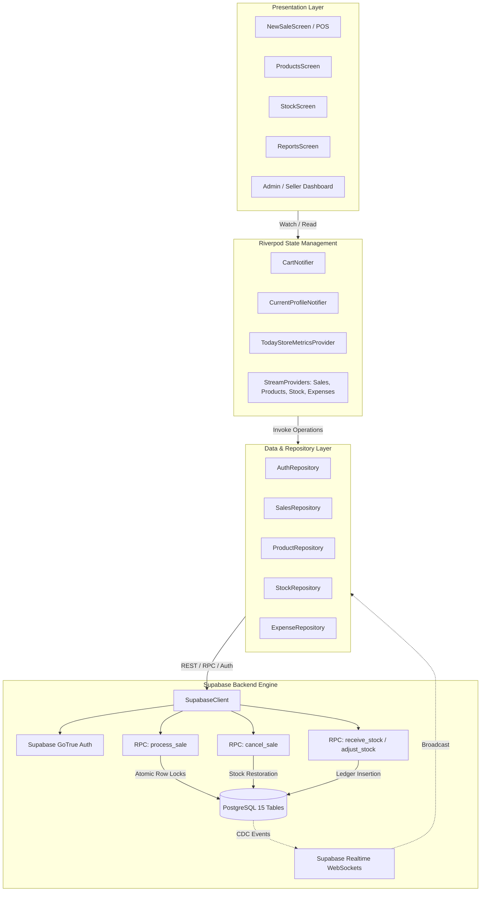

# Nammalvar — Natural Store POS & Retail Management System

[-02569B?logo=flutter&logoColor=white)](#11-testing-and-verification)
[-4CAF50?logo=dart&logoColor=white)](#11-testing-and-verification)
[](docs/SUPABASE-SETUP.md)
[](docs/ARCHITECTURE.md)
[](LICENSE)

A production-grade, multi-terminal retail Point of Sale (POS) and inventory management application built with **Flutter** and **Supabase (PostgreSQL)** for **Nammalvar Iyerkai Angadi** (*Organic & Traditional Products Store*).

The application features **Role-Based Access Control (Admin vs. Seller)**, **concurrency-safe atomic checkout procedures (`FOR UPDATE` row locks)**, **real-time inventory synchronization**, **immutable stock movement ledgers**, and **high-fidelity financial exports (Unicode-safe PDF and multi-sheet Excel workbooks)**.

---

## 1. Executive Summary

| Attribute | Specification |
|---|---|
| **Product Name** | **Nammalvar Iyerkai Angadi** |
| **Domain** | Retail Point of Sale (POS), Inventory Control & Financial Store Auditing |
| **Target Users** | Store Owners / Administrators and Frontline Cashiers / Retail Staff |
| **Frontend Framework**| Flutter (Dart 3.x), Material 3 Design |
| **State Management**| Riverpod 2.0 (StateNotifier, StreamProvider, Computed Analytics) |
| **Backend & Database**| Supabase BaaS, PostgreSQL 15, Stored Procedures (PL/pgSQL), Realtime WebSockets |
| **Security Architecture**| Row Level Security (RLS), Server-side JWT Role Evaluation, Row-level write locking |
| **Reporting & Export**| Bundle-backed TrueType Unicode PDF (`₹` Rupee rendering), 4-sheet Excel (`.xlsx`) |

---

## 2. Problem Statement & Solution

### The Challenge
Independent organic grocery and traditional wellness stores often manage dynamic product catalogs (traditional rice varieties sold by weight, herbal soaps, oils, natural shampoos) across multiple counter terminals. Typical challenges include:
1. **Overselling & Inventory Drift**: Multiple cashiers concurrently checking out the last remaining stock items.
2. **Staff Attribution Gaps**: Inability to isolate individual seller sales from overall register takings.
3. **Data Leaks on Cashier Terminals**: Frontline staff having unauthorized visibility into sensitive procurement cost prices and store profit margins.
4. **Encoding Errors in Financial Reporting**: Digital receipts and PDF export systems breaking when rendering regional Indian currency symbols (`₹`).

### The Implemented Solution
- **ACID-Compliant Server-Side Checkout**: The POS checkout delegates transactions to a PostgreSQL stored procedure (`process_sale`) that acquires pessimistic row locks (`SELECT ... FOR UPDATE`), strictly preventing negative stock and race conditions.
- **Granular Role-Based Access Control**: Admins receive an 8-tab operational command center with margins, cost prices, stock adjustments, and global sales histories. Sellers receive a focused 5-tab checkout terminal where cost prices and store revenue figures are omitted.
- **Real-Time CDC Synchronization**: PostgreSQL Change Data Capture (CDC) events broadcast catalog updates to all active terminals via WebSockets with zero manual polling.
- **Enterprise-Grade Audit Reports**: Dedicated pipelines generate print-ready daily closing summaries with Unicode font fallbacks and 4-sheet formatted Excel spreadsheets.

---

## 3. Application Screenshots & User Journey

> [!NOTE]
> All screenshots below are genuine interface captures from live retail testing devices. Personal email addresses have been securely audited per [docs/SCREENSHOTS.md](docs/SCREENSHOTS.md).

### Core Operational Workflow

| 01. Secure Authentication | 02. Admin Command Dashboard | 03. Seller Terminal Dashboard |
|:---:|:---:|:---:|
| [](screenshots/01-login.png) | [](screenshots/02-admin-dashboard.png) | [](screenshots/03-seller-dashboard.png) |
| *Tamil store branding, credential validation & role detection* | *Store KPI cards, payment splits, gross margin & seller totals* | *Personal cashier daily metrics, recent bills & quick-sale trigger* |

---

### Point of Sale (POS) & Checkout Engine

| 04. Fast POS Catalog Terminal | 05. Review & Checkout Modal | 06. Instant Sale Confirmation |
|:---:|:---:|:---:|
| [](screenshots/04-pos-sale-terminal.png) | [](screenshots/05-pos-checkout-modal.png) | [](screenshots/06-pos-sale-success.png) |
| *Real-time search, category chips, live stock & cart counter* | *Seller attribution, line item breakdown, Cash / UPI / Other split* | *Server-confirmed receipt #0028 with atomic stock reduction* |

---

### Inventory Control & Role-Based Catalog Views

| 07. Admin Catalog (with Cost & Add) | 08. Seller Catalog (Restricted) | 09. Stock & Ledger Management |
|:---:|:---:|:---:|
| [](screenshots/07-admin-products-catalog.png) | [](screenshots/08-seller-products-catalog.png) | [](screenshots/09-stock-inventory.png) |
| *Reveals purchase cost, profit margins & edit/add controls* | *Sanitized cashier view: cost rates & admin controls hidden* | *Inward stock receiving, cycle count adjustments & ledger* |

---

### Sales Auditing & End-of-Day Financial Analytics

| 10. Store-Wide Sales Audit Ledger | 11. Seller Personal Sales (RLS) | 12. Daily Closing & PDF/Excel Export |
|:---:|:---:|:---:|
| [](screenshots/10-store-sales-history.png) | [](screenshots/11-seller-sales-history.png) | [](screenshots/12-reports-daily-closing.png) |
| *Comprehensive multi-seller transactions across store* | *Cashier-restricted view enforced by PostgreSQL RLS* | *End-of-day register settlement with multi-format export* |

---

### Financial Deep Dive: Attribution & Margins

| 13. Seller Product Attribution Tracking | 14. Estimated Profit & Loss Statement |
|:---:|:---:|
| [](screenshots/13-reports-seller-tracking.png) | [](screenshots/14-reports-profit-and-loss.png) |
| *Itemized staff attribution audit showing who sold which item* | *Automated breakdown: Revenue, COGS, Gross Profit, Expenses, Net Profit* |

*For complete screen descriptions and the exclusion audit log, consult [docs/SCREENSHOTS.md](docs/SCREENSHOTS.md).*

---

## 4. Key Features

### Implemented Features
- **Point of Sale (POS) Checkout**: High-speed catalog search, category filtering chips, custom rate overrides, quantity steppers, and multi-channel payment method classification (`cash`, `upi`, `other`).
- **Atomic Concurrency Protection**: Database-level pessimistic row locking (`SELECT ... FOR UPDATE`) in `process_sale` guarantees zero over-selling during simultaneous checkouts.
- **Role-Based Access Control (RBAC)**: Distinct navigation hierarchies and view models for Administrators (8 operational tabs) and Sellers (5 focused tabs).
- **Inventory & Stock Management**: Inward stock receiving with invoice numbers, physical cycle adjustments with mandatory audit reasoning, and an immutable ledger in `public.stock_movements`.
- **Sale Cancellation with Reversing Ledger**: Admin-authorized cancellation procedure (`cancel_sale`) restoring product stock atomically and recording reverse ledger entries.
- **Automatic Price History Auditing**: PostgreSQL database triggers (`trg_track_price_change`) automatically logging price changes into `public.price_history`.
- **Financial Analytics & Store Closing**: Daily register settlement calculating total takings, payment splits, transaction volume, and seller performance.
- **High-Fidelity Document Exports**:
  - **PDF Export**: Uses bundled TrueType Unicode fonts (`Arial-Regular.ttf` and `Arial-Bold.ttf`) to natively print the Indian Rupee symbol (`₹`).
  - **Excel Workbook (`.xlsx`)**: Generates 4-sheet workbooks (Summary, Sales, Sale Items, Expenses) with typed numerical data cells.
- **Operational Expense Logging**: Expense entries categorized into Transport, Packaging, Rent, Electricity, Maintenance, and Wages.
- **Offline & Unit Test Harnesses**: Built-in mock structures allowing deterministic offline unit and widget testing without an active network connection.

### Partially Implemented & Planned
- **Thermal Receipt Printer Integration**: Digital PDF sharing is fully functional; direct Bluetooth ESC/POS raw hardware pairing is planned.
- **Hardware Barcode Scanner**: Instant text and SKU search is implemented; camera optical scanning is planned.

*For an exhaustive mapping of features to source code files, refer to [docs/FEATURES.md](docs/FEATURES.md).*

---

## 5. Technology Stack & Dependencies

```text
Frontend Framework:
  • Flutter SDK 3.47.2 (Channel stable)
  • Dart SDK 3.13.2

State Management & Architecture:
  • flutter_riverpod: ^2.6.1   (Dependency injection & reactive state)
  • shared_preferences: ^2.3.5 (Local terminal persistence)
  • uuid: ^4.5.1               (Client-side UUID generation)

Backend as a Service (Supabase):
  • supabase_flutter: ^2.8.0   (Auth, Realtime WebSockets, PostgREST & RPC client)
  • PostgreSQL 15 Engine       (ACID relational storage & stored procedures)

Visuals, UI & Charts:
  • google_fonts: ^6.2.1       (Outfit & typography styling)
  • fl_chart: ^0.70.2          (Financial and sales data visualization)
  • cupertino_icons: ^1.0.8    (iOS/Material iconography)

Document Generation & Export:
  • pdf: ^3.11.1               (TrueType font document layout engine)
  • printing: ^5.13.2          (Native print spooler & share sheet)
  • excel: ^4.0.6              (Multi-sheet .xlsx spreadsheet builder)
  • intl: ^0.19.0              (Date and numerical localization)
```

---

## 6. Architecture & Data Flow

Nammalvar adheres strictly to **Clean Architecture** principles, enforcing directional dependencies from Presentation through Domain to Data.



*For in-depth architectural patterns and concurrency models, see [docs/ARCHITECTURE.md](docs/ARCHITECTURE.md).*

---

## 7. Supabase Database Integration

The backend is driven by 12 relational tables and 5 stored procedures:

```text
Database Schema Structure:
├── public.profiles           (Staff accounts linked to auth.users with user_role)
├── public.categories         (Self-referencing hierarchical category taxonomy)
├── public.products           (Catalog items with selling price, cost, stock & unit)
├── public.sales              (Transaction headers with serial sale_number & seller_id)
├── public.sale_items         (Immutable line-item price & quantity snapshots)
├── public.stock_movements    (Audit ledger logging every inventory alteration)
├── public.price_history      (Automated audit trail managed by database triggers)
├── public.suppliers          (Supplier and organic vendor directory)
├── public.purchases          (Inward stock shipment headers)
├── public.purchase_items     (Line items for inward stock purchases)
├── public.expenses           (Store operational overhead expenditure records)
└── public.activity_logs      (System and security audit events)
```

### Stored Procedures (RPCs)
- **`process_sale(p_payment_method, p_items)`**: Validates caller session via `auth.uid()`, locks product rows (`FOR UPDATE`), checks stock invariants, reduces stock, creates sale header, snapshots sale items, appends stock movement ledger entries, and writes activity logs atomically.
- **`cancel_sale(p_sale_id, p_reason)`**: Validates caller administrative rights via `is_admin()`, reverses stock deductions, appends `sale_cancel` ledger rows, and marks sale cancelled with mandatory reasoning.
- **`receive_stock(...)`**: Admin-authorized inward shipment receiving.
- **`adjust_stock(...)`**: Admin-authorized physical cycle adjustments with audit reasoning.

*For complete migration scripts, table schemas, and deployment instructions, refer to [docs/SUPABASE-SETUP.md](docs/SUPABASE-SETUP.md).*

---

## 8. Repository Structure

```text
nammalvar-iyerkai-angadi/
├── .env.example              # Sanitized environment configuration template
├── .gitignore                # Hardened exclusions for secrets, temp files & keystores
├── analysis_options.yaml     # Recommended Flutter & Dart linting rules
├── LICENSE                   # MIT Open-Source License
├── pubspec.yaml              # Application manifest & package dependencies
├── pubspec.lock              # Deterministic lockfile
├── README.md                 # Primary documentation showcase
├── assets/
│   ├── fonts/                # TrueType Unicode fonts (Arial-Regular, Arial-Bold, Tamil)
│   └── images/               # Application icons, branding, and splash assets
├── screenshots/              # 14 curated genuine application screenshots
├── docs/
│   ├── ARCHITECTURE.md       # Clean architecture, state management & data flows
│   ├── FEATURES.md           # Implemented feature inventory & RBAC matrix
│   ├── SCREENSHOTS.md        # Screenshot index, descriptions & exclusion audit
│   ├── SECURITY.md           # Security posture, RLS audit & vulnerability analysis
│   └── SUPABASE-SETUP.md     # PostgreSQL schema, migrations & RPC deployment
├── lib/
│   ├── main.dart             # App entrypoint & ProviderScope container
│   ├── core/                 # Shared constants, network config, theme, and formatters
│   └── features/             # Modular feature packages (auth, sales, stock, reports, etc.)
├── supabase/
│   └── migrations/           # 00001_initial_schema.sql & 00002_seed_data.sql
└── test/                     # Unit, business rule, and widget test suites
```

---

## 9. Setup & Installation

### Prerequisites
- **Flutter SDK**: `^3.47.2` (Channel stable)
- **Dart SDK**: `^3.13.2`
- **Git**
- An active **Supabase** project (or local Supabase instance)

### Step 1: Clone Repository
```bash
git clone https://github.com/Abhi-wizard/nammalvar-iyerkai-angadi.git
cd nammalvar-iyerkai-angadi
```

### Step 2: Install Dependencies
```bash
flutter pub get
```

### Step 3: Configure Environment Credentials
Nammalvar supports compile-time variables or `.env` templates:

```bash
# Option A: Compile-Time Flags (Recommended for Production / CI)
flutter run \
  --dart-define=SUPABASE_URL="https://your-project.supabase.co" \
  --dart-define=SUPABASE_ANON_KEY="your-anon-publishable-key"

# Option B: Copy Template
cp .env.example .env
# Edit .env with your project credentials
```

### Step 4: Run Application
```bash
# Launch on connected Android device, iOS simulator, or desktop
flutter run
```

---

## 10. Security & Configuration Audit

A rigorous security audit was conducted on this codebase:
- **No Privileged Keys Committed**: Zero Supabase service-role keys or raw database passwords exist in source files or Git commit history.
- **Safe Anonymous Key Distribution**: The embedded fallback key is strictly an unprivileged `anon` key whose data access is constrained by PostgreSQL Row Level Security (RLS).
- **Hardened Git Hygiene**: `.gitignore` explicitly prevents accidental commits of `.env` files, Android keystores, iOS provisioning profiles, and Supabase CLI state (`supabase/.temp/`).
- **Personal Data Protection**: Screenshots depicting actual administrative email addresses were audited, flagged, and excluded from the public repository showcase.

*For detailed security controls and vulnerability mitigation strategies, see [docs/SECURITY.md](docs/SECURITY.md).*

---

## 11. Testing & Verification

The codebase has undergone full static analysis and automated test verification:

### Static Analysis
```bash
flutter analyze
```
**Result**: `No issues found! (ran in 57.6s)` — Clean across all 25+ application modules with zero warnings or errors.

### Automated Test Suite
```bash
flutter test
```
**Result**: `All tests passed! (22 passing test steps)`

```text
Verified Test Suites:
  ✔ Security & Authorization Gate (Unauthenticated sales blocked)
  ✔ Seller Role Protection (Impersonation blocked in production)
  ✔ Non-Admin Sales Cancellation Guard (Permission denied enforced)
  ✔ Authorized Admin Stock Adjustments & Cancellations
  ✔ Stock Safety Invariant (Over-selling strictly rejected)
  ✔ Atomic Sale & Stock Reduction Invariant
  ✔ Reversing Stock Ledger on Sale Cancellation
  ✔ Multi-Seller Revenue Aggregation
  ✔ TrueType Unicode Font PDF Rendering (₹ Rupee symbol integrity)
  ✔ 4-Sheet Excel (.xlsx) Multi-Tab Export Engine
  ✔ Responsive POS Viewports (Zero layout overflow on 320px screens)
  ✔ Widget Authentication Shell & Navigation Rendering
```

---

## 12. Known Limitations & Setup Requirements

1. **Live Supabase Schema Requirement**: Running multi-user realtime sync requires linking to an active Supabase project with `00001_initial_schema.sql` and `00002_seed_data.sql` applied. Offline mode automatically falls back to deterministic mock profiles for unit testing.
2. **Thermal Receipt Hardware**: Digital receipt generation and system sharing via PDF are fully implemented; direct Bluetooth ESC/POS raw socket printing requires pairing with compatible ESC/POS hardware.
3. **Barcode Scanning**: Real-time keyword and SKU search is implemented; camera barcode scanning requires integrating an optical camera plugin.

---

## 13. Documentation Sitemap

- [**docs/ARCHITECTURE.md**](docs/ARCHITECTURE.md) — Architectural patterns, Riverpod state lifecycle, and concurrency control.
- [**docs/SUPABASE-SETUP.md**](docs/SUPABASE-SETUP.md) — Relational schema, migrations, RPC definitions, and RLS policies.
- [**docs/FEATURES.md**](docs/FEATURES.md) — Comprehensive feature matrix, RBAC definitions, and export pipelines.
- [**docs/SCREENSHOTS.md**](docs/SCREENSHOTS.md) — Curated visual showcase, screen descriptions, and screenshot audit log.
- [**docs/SECURITY.md**](docs/SECURITY.md) — Security posture, RLS boundary evaluation, and privacy disclosures.

---

## 14. Author & License

- **Developer**: Abhimanue ([@Abhi-wizard](https://github.com/Abhi-wizard))
- **Repository**: [https://github.com/Abhi-wizard/nammalvar-iyerkai-angadi](https://github.com/Abhi-wizard/nammalvar-iyerkai-angadi)
- **License**: Released under the [MIT License](LICENSE).
