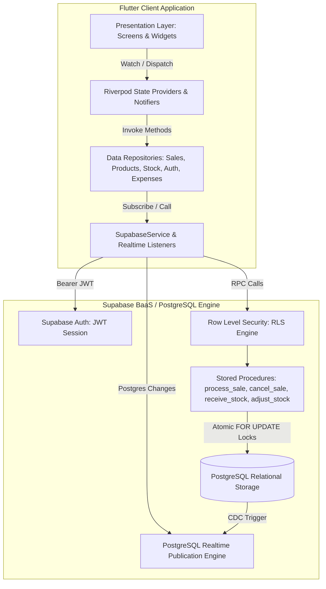

# System Architecture — Nammalvar Iyerkai Angadi

This document outlines the software engineering architecture, state management patterns, and backend integration design for the **Nammalvar** Flutter retail management and Point of Sale (POS) system.

---

## 1. Architectural Overview

Nammalvar is engineered following the **Clean Architecture** and **Layered Separation of Concerns (SoC)** paradigms. The system enforces strict boundaries between:
- **Presentation Layer**: Flutter UI widgets, theme styling, and user interaction handling.
- **State Management Layer**: Riverpod `StateNotifier`, `StreamProvider`, and `Provider` instances managing reactive state.
- **Domain Layer**: Immutable data models, entity schemas, and business validation rules.
- **Data & Service Layer**: Repositories abstracting Supabase PostgreSQL RPCs, Realtime channels, and offline fallback harnesses.



---

## 2. Layered Structure & Module Responsibilities

```text
lib/
├── core/
│   ├── constants/        # Centralized app constants, units, and fallback keys
│   ├── network/          # Supabase client singleton, credential resolver
│   ├── theme/            # Color palettes, typography, and Material 3 theme data
│   ├── utils/            # Currency (₹), date, and quantity formatting utilities
│   └── widgets/          # Shared components (AppCard, StatusBadge)
├── features/
│   ├── auth/             # Authentication, session listening, ProfileModel
│   ├── dashboard/        # Role-gated Navigation Shell, Admin & Seller dashboards
│   ├── expenses/         # Store expense tracking and category classification
│   ├── products/         # Product catalog, category hierarchies, and pricing
│   ├── reports/          # Store closing, profit/loss, PDF & Excel export pipelines
│   ├── sales/            # POS terminal, cart provider, checkout, and sales history
│   ├── settings/         # Terminal metadata, active user profile, sign out
│   └── stock/            # Inward receiving, inventory adjustments, and movement ledger
└── main.dart             # Application entrypoint & ProviderScope container
```

---

## 3. State Management (Riverpod 2.0)

The application utilizes **Riverpod** for reactive, compile-safe dependency injection and state lifecycle management:

1. **`ProviderScope` Container**: Wraps the root `NammalvarApp` widget in `lib/main.dart`.
2. **Dynamic Role Switching**:
   - `currentProfileProvider` observes the active user profile and triggers dynamic interface reconfiguration (`AdminDashboard` vs `SellerDashboard`).
3. **Reactive Stream Providers**:
   - `productsStreamProvider`, `salesStreamProvider`, `stockMovementsStreamProvider`, and `expensesStreamProvider` bind directly to repository streams.
4. **Computed Analytics Providers**:
   - `todayStoreMetricsProvider` computes revenue, item counts, payment breakdowns, and gross margins on-the-fly from incoming sales events.

---

## 4. Realtime Data Synchronization

Multi-terminal retail environments require zero-latency inventory and sales reconciliation across multiple checkout counters:

- The client establishes WebSocket channels using `supabase_flutter` Realtime:
  ```dart
  client.channel('public:products')
      .onPostgresChanges(
        event: PostgresChangeEvent.all,
        schema: 'public',
        table: 'products',
        callback: (payload) => refreshProducts(),
      )
      .subscribe();
  ```
- Any transaction processed at Counter #1 immediately broadcasts change data capture (CDC) events to Counter #2, updating available stock counters in real time.

---

## 5. Concurrency Control & Atomic Transactions

In retail environments, concurrent checkouts on the last remaining stock item must never result in negative inventory or race conditions:

- **Server-Side Transaction Boundary**: Checkout does not perform multiple separate client-side REST updates. Instead, the entire cart payload is sent to the `process_sale` PostgreSQL stored procedure.
- **Pessimistic Row Locking (`FOR UPDATE`)**: The database locks each product row in sequence:
  ```sql
  SELECT * INTO v_product
  FROM public.products
  WHERE id = v_product_id
  FOR UPDATE;
  ```
- **Invariant Enforcement**: If requested quantity exceeds `current_stock`, the stored procedure aborts immediately and rolls back the entire transaction, guaranteeing stock integrity.

---

## 6. Document Export Pipeline

The reporting subsystem integrates standalone export pipelines:
- **PDF Generation (`pdf` / `printing`)**: Uses bundled TrueType Unicode fonts (`Arial-Regular.ttf` and `Arial-Bold.ttf`) to natively render the Indian Rupee symbol (`₹`) without glyph substitution errors.
- **Multi-Sheet Excel Workbook (`excel`)**: Constructs a 4-sheet `.xlsx` document containing typed numerical metrics for Summary, Sales, Sale Items, and Expenses.
