# Visual Showcase & Screenshot Index — Nammalvar

This document catalogues the genuine application screenshots captured from live Android retail testing devices, organized into an end-to-end user journey across both **Administrator** and **Seller** personas.

---

## 1. Curated User Journey Showcase

### Sequence 1: Authentication & Entry

| Step | Screenshot | Screen Name & Description |
|:---:|---|---|
| **01** | 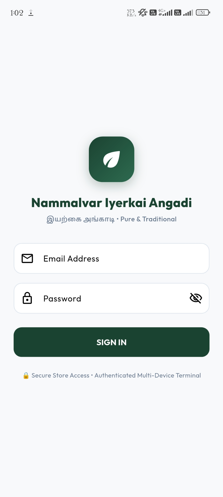 | **Secure Store Access / Login Screen** Clean authentication interface featuring Nammalvar branding, Tamil tagline (`இயற்கை அங்காடி`), credential validation, and password visibility toggling. |

---

### Sequence 2: Role-Specific Dashboards

| Step | Screenshot | Screen Name & Description |
|:---:|---|---|
| **02** | 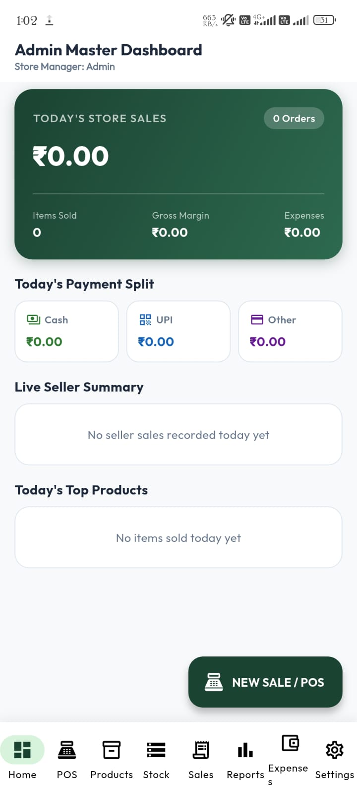 | **Admin Master Dashboard** Real-time high-level store overview displaying total store revenue, order counts, items sold, gross margins, expense deductions, and multi-channel payment split (Cash / UPI / Other). |
| **03** | 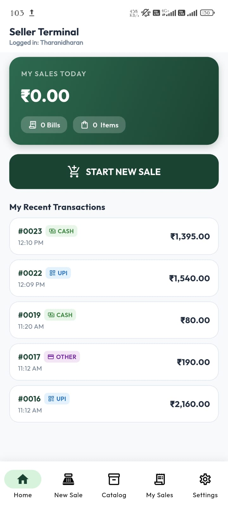 | **Seller Terminal Dashboard** Streamlined cashier dashboard tailored for frontline sales staff, showcasing personal daily sales totals, transaction counts, recent receipts, and a one-tap shortcut to launch the POS terminal. |

---

### Sequence 3: Point of Sale (POS) & Checkout Engine

| Step | Screenshot | Screen Name & Description |
|:---:|---|---|
| **04** | 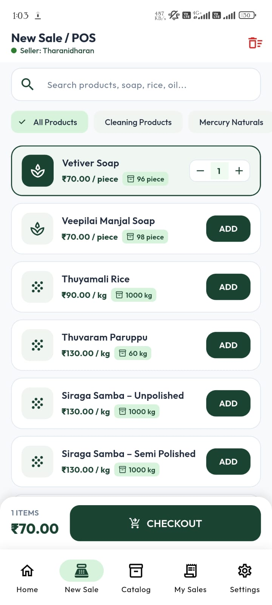 | **POS Fast Sale Terminal** Live catalog browsing with instant search, category filtering chips (*Cleaning Products, Mercury Naturals, Rice*), real-time stock counters, and an interactive floating checkout bar. |
| **05** | 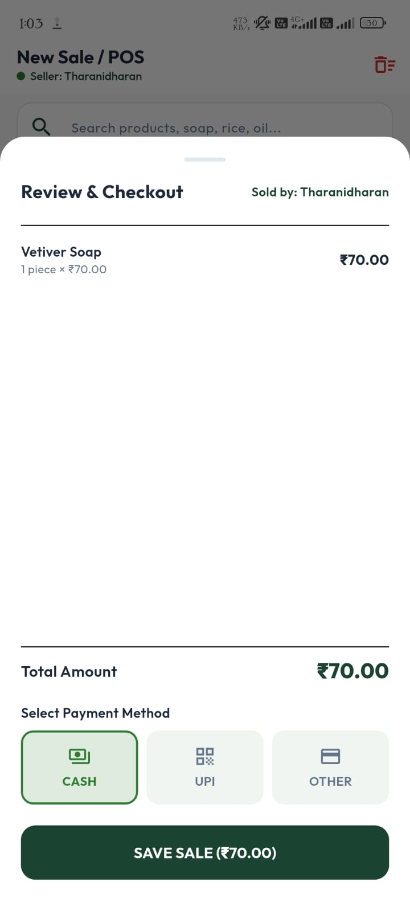 | **Review & Checkout Modal** Detailed cart inspection modal attributing the transaction to the authenticated seller (`Tharanidharan`), itemizing line totals, and presenting payment method selection (Cash, UPI, Other). |
| **06** | 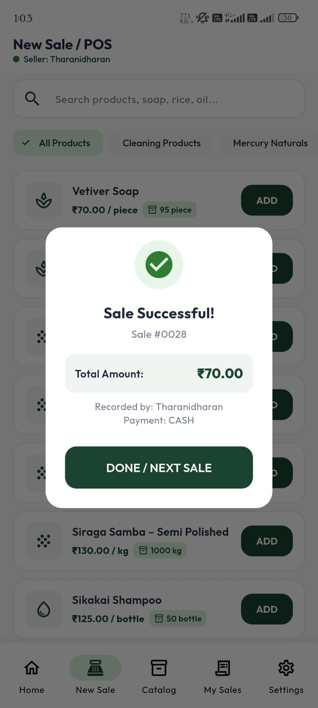 | **Instant Transaction Confirmation** Real-time confirmation modal acknowledging successful execution of PostgreSQL atomic sale RPC (`process_sale`), returning serial receipt `#0028` and immediately synchronizing stock counters. |

---

### Sequence 4: Product Catalog & Role-Based Access Control

| Step | Screenshot | Screen Name & Description |
|:---:|---|---|
| **07** | 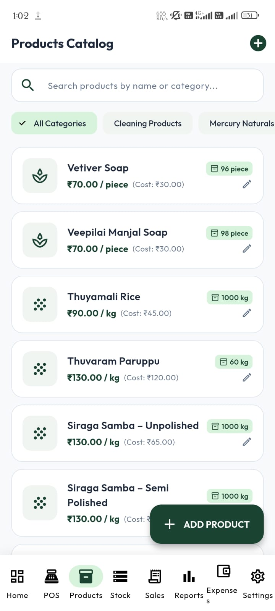 | **Admin Product Catalog Management** Full administrative catalog view revealing purchase cost prices (e.g., `Vetiver Soap: Cost ₹30.00`), gross margin awareness, product edit pencil triggers, and the "+ ADD PRODUCT" floating button. |
| **08** | 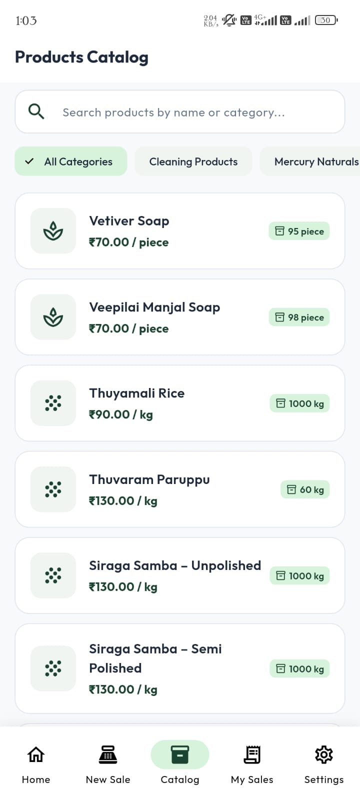 | **Seller Product Catalog (Restricted View)** Cashier-facing catalog enforcing strict data privacy; cost prices and margin calculations are omitted, and administrative modification controls are disabled. |

---

### Sequence 5: Inventory Control & Stock Ledgers

| Step | Screenshot | Screen Name & Description |
|:---:|---|---|
| **09** | 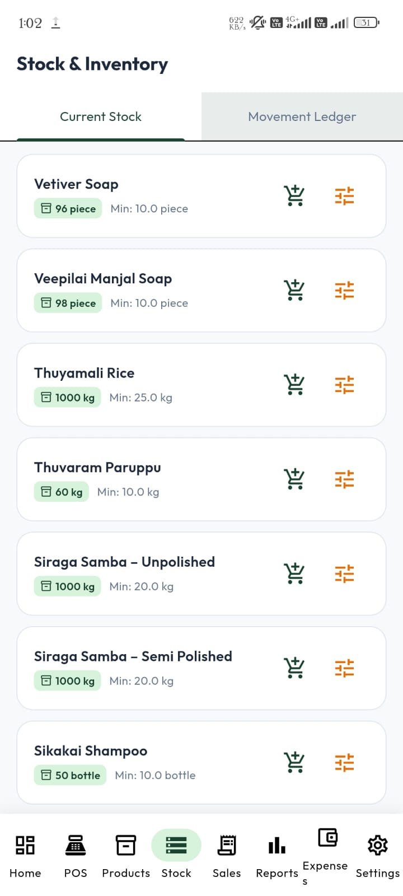 | **Stock & Inventory Management** Inventory surveillance dashboard showing unit stock levels against minimum safety thresholds, with direct action triggers for inward purchase receiving (`receive_stock`) and physical cycle count adjustments (`adjust_stock`). |

---

### Sequence 6: Sales History & Audit Trails

| Step | Screenshot | Screen Name & Description |
|:---:|---|---|
| **10** | 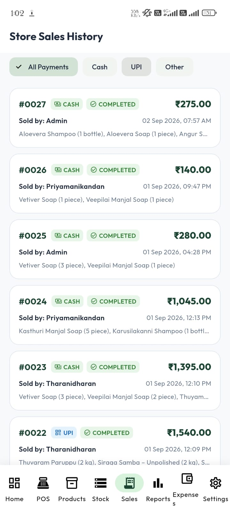 | **Global Store Sales History (Admin View)** Store-wide chronological sales ledger capturing transactions across all active counter personnel (`Admin`, `Priyamanikandan`, `Tharanidharan`), payment methods, and invoice item details. |
| **11** | 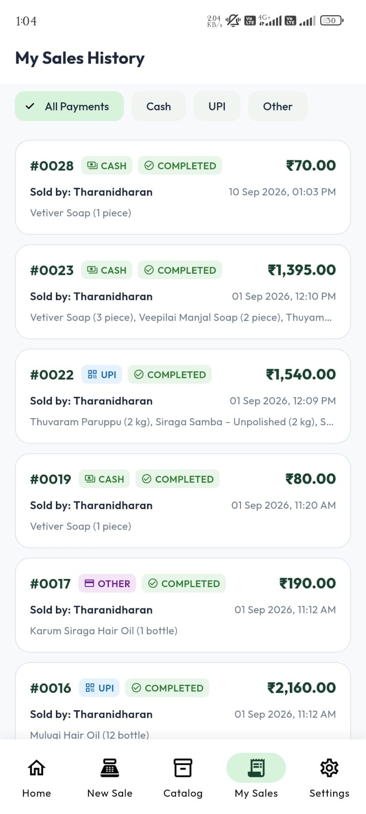 | **Personal Sales History (Seller View)** Row Level Security (RLS) enforced transaction history displaying solely the invoices generated by the authenticated cashier (`Tharanidharan`). |

---

### Sequence 7: Financial Analytics & Store Closing

| Step | Screenshot | Screen Name & Description |
|:---:|---|---|
| **12** | 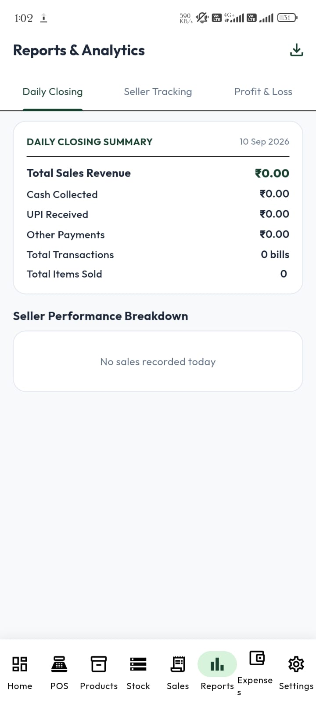 | **Reports & Analytics — Daily Store Closing** Comprehensive end-of-day register settlement summarizing total revenue, cash in drawer, UPI settlements, transaction volume, and total units sold. Features export trigger for PDF and Excel generation. |
| **13** | 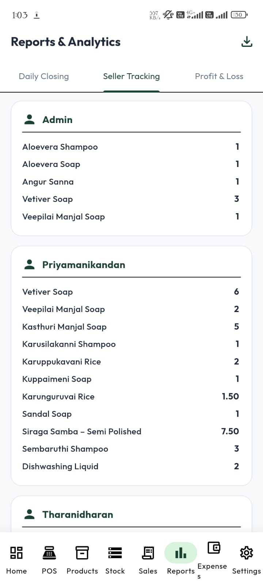 | **Reports & Analytics — Seller Product Tracking** Granular staff attribution report itemizing exactly which employee sold which products and quantities throughout the business day. |
| **14** | 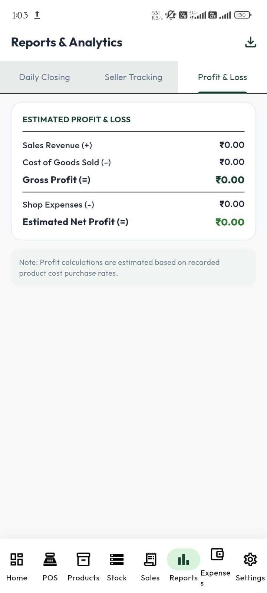 | **Reports & Analytics — Profit & Loss** Automated financial breakdown factoring Sales Revenue (+), Cost of Goods Sold (-), Gross Profit (=), Daily Operating Expenses (-), and Net Profit Margin (=). |

---

## 2. Screenshot Discovery & Selection Audit

A complete audit of the original screenshot folder (`C:\Users\ABHIMANYU\Pictures\nammalvar app image`) was conducted:

- **Total Screenshots Discovered**: 16 image files.
- **Total Screenshots Selected**: 14 files copied into `screenshots/`.
- **Total Screenshots Excluded**: 2 files.

### Detailed Exclusion Log

| Original Image Filename | Screen Depicted | Reason for Exclusion | Remediation |
|---|---|---|---|
| `ca57c581-7a57-4792-a402-8d48eebc1f5c.png` | Admin Settings & Account | Contains real personal email address (`abhimanyutharanidharan@gmail.com`). Excluded to uphold personal data privacy in open-source portfolio repositories. | Can be published once the email string is redacted or replaced with a mock identifier. |
| `d4960104-edbb-417b-90b8-bb1994350590.png` | Seller Settings & Account | Contains real personal email address (`stdharan73@gmail.com`). Excluded to uphold personal data privacy. | Can be published once the email string is redacted or replaced with a mock identifier. |
